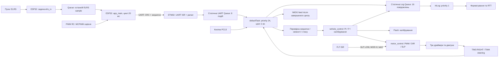
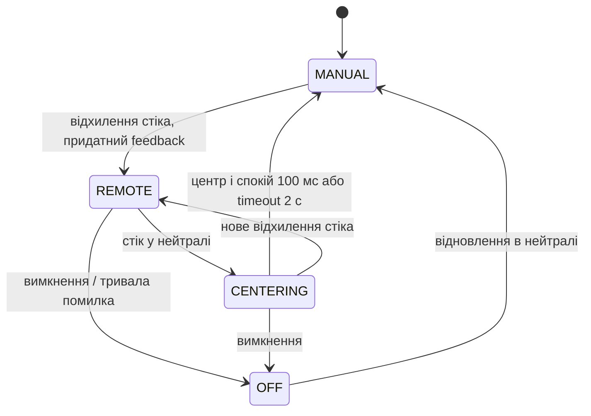

# Архітектура та алгоритми

## Потоки даних

ESP32 вибирає перше валідне джерело ELRS/PWM і зберігає його, доки
воно придатне. При втраті джерела надсилає ERROR, повертається до NONE,
потім повторює вибір. За однакового часу набуття валідності перевага ELRS.

## Задачі та синхронізація

| Задача STM32 | Пріоритет FreeRTOS | Стек | Робота |
| --- | --- | --- | --- |
| `defaultTask` | 24 | Статичні 4096 байтів | Пульт, енкодери, регулятори, калібрування, FLT та IWDG |
| `rttLog` | 1 | Статичні 4096 байтів | Форматування та неблокуючий RTT; очікує Log Queue |

Задача керування використовує `vTaskDelayUntil` із періодом 1 мс.
Внутрішній крок обох регуляторів — 10 мс; обчислення враховують фактичний
elapsed.

UART ISR передає перевірені команди та помилки через FIFO. При переповненні
зберігається прийнятий префікс і час першої втрати, після нього задача
отримує invalid-подію. Відновлення RX із задачі захищене від UART ISR
короткою секцією зі збереженням PRIMASK. Знімки датчиків також узгоджені
між ISR та задачею. На ESP32 PWM capture використовує `portMUX`.

Тільки `defaultTask` керує моторами у звичайному режимі. Аварійний FLT ISR
може негайно вимкнути їх. Логер отримує копії значень та час події,
не читає живі контролери й не годує IWDG. Producer Log Queue має wait=0;
при заповненні нове повідомлення відкидається. Рядкові вказівники в
повідомленнях посилаються лише на незмінні літерали. Окремий mutex для
моторів або RTT не потрібний за такого володіння даними.

`defaultTask` створюється через CMSIS-RTOS2, `rttLog` — через
`xTaskCreateStatic` у `vehicle_log_start`, викликаному з USER CODE
RTOS_THREADS перед запуском планувальника. Черги, стеки й TCB статичні.

## Розподіл модулів

| Модуль | Відповідальність |
| --- | --- |
| `shared/remote_protocol` | Типи, формат пакета, CRC, обмежений парсер |
| `remote_uart` | Приймання байтів, події UART, FIFO, recovery |
| `remote_command_monitor` | Sequence, timeout, допуск коротких збоїв |
| `steering_encoder`, `rear_encoders`, `wheel_speed` | Придатність і перетворення вимірювань |
| `vehicle_control` | Компонування керма/приводу, кнопка, режими калібрування |
| `drive_controller`, `steering_controller` | PI швидкості та P положення |
| `motor_control`, `motor_safety` | Моторні виходи, інверсії, FLT та аварійне вимкнення |
| `steering_calibration`, `steering_calibration_storage` | Геометрія трьох точок і Flash |
| `vehicle_log`, `vehicle_log_format`, `debug_console` | Черга, задача логування, форматування й RTT |

## Задній привід

Стік задає швидкість. Режими 1/2 обмежують завдання до 1111/1666 мм/с
(4/6 км/год із округленням униз), режим 3 використовує номінальну шкалу
2800 RPM. Модуль стіка від 990 у режимі 3 запитує повний PWM.

Спільний PI із feed-forward використовує швидкість RIGHT. Обидва задні
двигуни отримують однаковий PWM. Anti-windup враховує насичення й межі
темпу. Звичайне наростання/спадання — 10/1000 за 10 мс; явне гальмування
та зміна напрямку — 20/1000 за 10 мс.

Дозвіл реверсу має стани BRAKE_REQUIRED, FORWARD_SEEN, WAIT_NEUTRAL,
READY та ACTIVE. Різке перше «назад» гальмує; потрібні нейтраль і
повторне «назад». Інший шлях — фактичний рух уперед, потім нейтраль,
PWM=0 та RIGHT у межах ±50 мм/с протягом 100 мс: наступне «назад» дозволене.
Перед зміною напрямку регулятор очікує нульового PWM та спокою колеса.
Тривала помилка й перезапуск скидають дозвіл реверсу.

Фази руху — IDLE, RUNNING, REVERSING, REVERSE_SETTLE, NEUTRAL_SETTLE.
Вони відокремлені від дозволу реверсу та діагностичного результату.

## Кермо

Поза нейтраллю ±30/1000 стік задає абсолютне положення за трьома точками
калібрування. P-регулятор використовує MT6701, обмежує PWM до 70%,
наростання виходу й рух за робочі межі. При повторному захопленні
починає з фактичного положення.

У MANUAL steering PWM=0 і steering SLP LOW. Ручний рух після звільнення
не запускає нове центрування. Задній привід працює незалежно від цього режиму.

## Помилки та межі

- Пошкоджені пакети й дублікати не оновлюють свіжість OK-команди.
  Допуск пульта — 60 мс від першої помилки, timeout останньої OK — 100 мс.
- До 40 мс непридатного feedback дозволене лише зменшення поточного PWM,
  без нового напрямку чи накопичення PI-помилки; далі вихід обнуляється.
- Таймінгова пауза від 50 мс обнуляє вихід регулятора.
- Будь-який FLT фіксується до reset та вимикає всі драйвери.
- IWDG номінально 500 мс підживлюється лише завершеним циклом керування;
  після IWDG reset потрібна нейтраль обох стіків.
- Сервісне калібрування тримає задні SLP LOW, steering PWM не більше 15%.
  Перед Flash-записом усі виходи вимкнені.

Параметри містяться в `drive_controller_config.h`,
`steering_controller_config.h`, `vehicle_input_config.h` та
`rear_encoder_config.h` у `firmware/vehicle-ecu/Core/Inc`.
